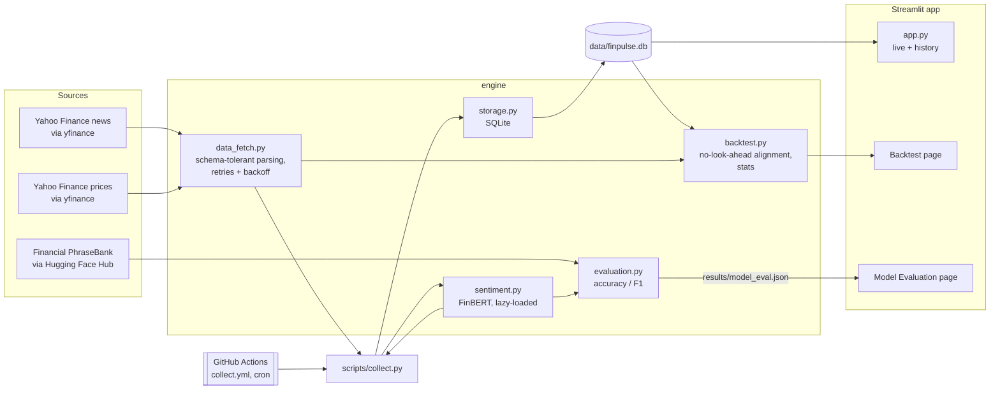

# FinPulse: Nifty 50 News Sentiment

[](https://github.com/Sleepiest1304/FinPulse/actions/workflows/ci.yml)
[](https://finpulse-nifty.streamlit.app/)

**Live demo:** https://finpulse-nifty.streamlit.app/

FinPulse collects recent Yahoo Finance headlines for the 50 stocks in India's Nifty 50 index and scores each one with [FinBERT](https://huggingface.co/ProsusAI/finbert), a BERT model fine-tuned for financial sentiment. It stores every scored headline in SQLite so a sentiment history builds up over time. It then tests that history against next-day and next-5-day stock returns and reports the results as they come out, including when they are weak.

> **Not financial advice.** FinPulse is a research and learning project. A correlation between headline sentiment and returns is not a prediction, and nothing here is a trading signal.

## Screenshots

| Live analysis | Backtest | Model evaluation |
|---|---|---|
|  |  |  |

Note the top row of the live analysis: FinBERT labels a fair-value *cut* as positive (0.93 confidence). It is a real example of the headline-level errors described under [Limitations](#limitations).


## What it does

- **Collect** (`scripts/collect.py`): fetches headlines for all Nifty 50 tickers (or a subset), scores the ones not seen before with FinBERT, and saves the ticker, title, publisher, link, publish time, fetch time, label, confidence and class probabilities to `data/finpulse.db`. A scheduled GitHub Action runs it twice each weekday and commits the database back to the repo.
- **Dashboard** (`app.py`): pick a stock, score its latest headlines live, optionally save them, and browse that stock's stored history.
- **Backtest** (`engine/backtest.py`, *Backtest* page, `scripts/backtest.py`): per ticker and pooled, compares the daily mean sentiment score with the forward 1-day and 5-day returns. Reports Pearson and Spearman correlation, a rough t-statistic, hit rate, the always-up baseline and sample size.
- **Model evaluation** (`scripts/evaluate_models.py`, *Model Evaluation* page): compares FinBERT with VADER and a majority-class baseline on Financial PhraseBank (accuracy, macro F1, weighted F1).

## Architecture



### Backtest method

1. Each headline is assigned to the first NSE close at which it was public. A headline published by 15:30 IST counts for that day's close. A later one counts for the next trading day. Weekends and holidays roll forward. When the source gives no publish time, the (later) fetch time is used.
2. Per stock and trading day *D*, the signal is the mean FinBERT score (P(positive) − P(negative), from −1 to +1) of that day's headlines.
3. The target is the adjusted-close return from *D* to *D+1* and *D+5*. The move on the headline's own day is **not** counted, so any reaction during that day is excluded by design.
4. **Hit rate** is the share of days where the sign of the score matches the sign of the return. It should be read against the **up-day rate**, the hit rate of always guessing "up".

## Results

### Model evaluation (Financial PhraseBank v1.0)

Measured 2026-11-23 by the *Evaluate models* workflow ([`results/model_eval.md`](results/model_eval.md)):

| Subset | Model | n | Accuracy | Macro F1 | Weighted F1 |
|---|---|---:|---:|---:|---:|
| allagree | majority (neutral) | 2264 | 0.614 | 0.254 | 0.468 |
| allagree | VADER | 2264 | 0.571 | 0.487 | 0.579 |
| allagree | FinBERT | 2264 | 0.972 | 0.963 | 0.972 |
| 50agree | majority (neutral) | 4846 | 0.594 | 0.248 | 0.443 |
| 50agree | VADER | 4846 | 0.543 | 0.489 | 0.549 |
| 50agree | FinBERT | 4846 | 0.890 | 0.883 | 0.891 |

Re-run it from Actions → *Evaluate models* → *Run workflow*.

**Important caveat:** `ProsusAI/finbert` was fine-tuned on Financial PhraseBank, so its scores on this dataset are largely in-sample and **overstate** how well it does on unseen headlines. The 0.97 on the unanimous-agreement subset says more about fit to training data than about how well it generalises. The 50agree subset adds sentences that human annotators disagreed on, which are harder for any model, and FinBERT drops to 0.89 there. VADER, a general-purpose lexicon model, has never seen this data, so it is the fairer reference. On accuracy it scores *below* the trivial "always neutral" baseline, but it does much better on macro F1.

### Backtest

First collection run, 2026-11-23: 370 headlines for 47 tickers (Yahoo returned none for ITC, JSWSTEEL and TRENT). Yahoo returns at most 10 headlines per ticker, but not only recent ones, so publish dates run from December 2025 to November 2026, mostly July to November 2026. Pooled across tickers:

| Horizon | n (stock-days) | Pearson r | Spearman ρ | t-stat | Hit rate | Up-day rate |
|---|---:|---:|---:|---:|---:|---:|
| 1 day | 305 | +0.003 | +0.020 | 0.06 | 55.4% | 54.1% |
| 5 day | 291 | −0.153 | −0.169 | −2.63 | 49.8% | 54.3% |

How to read this:

- **1 day:** no measurable relationship. The hit rate is about one point above the always-up baseline, which is within noise.
- **5 day:** a weak *negative* correlation. More positive headlines went with slightly lower returns over the next five days, and the hit rate is *below* the always-up baseline. The t-stat looks notable but is overstated: 5-day windows on consecutive days overlap, stocks co-move, and this is one of 2 horizons × 47 tickers tested. Treat it as noise until it holds up on later, out-of-sample data.
- **Sample:** the sample is small and not a random draw. It contains only the headlines Yahoo still served on one day, spread unevenly over a year (1 to 10 per ticker).

The collector workflow refreshes these numbers in [`results/backtest_summary.csv`](results/backtest_summary.csv), including per-ticker rows, and the Backtest page computes them live. The table above records the first run and will not update itself.

## Limitations

- **Correlation is not prediction.** Even a statistically significant correlation in this setup would not mean you could trade on it profitably: transaction costs, slippage and multiple-testing across 50 tickers × 2 horizons are not accounted for.
- **Small, biased news sample.** Yahoo Finance's feed is mostly English-language, international-facing coverage, often syndicated or auto-generated ("fair value estimate" style stories). It is not representative of the news Indian market participants act on. Some items are only loosely related to the stock they are filed under (for example, a general piece on the US housing market listed for Apollo Hospitals), which adds noise to that stock's score.
- **Headline-only, off-domain model.** FinBERT reads only titles, truncated to 128 tokens, and was fine-tuned on English financial news about Finnish companies (Financial PhraseBank), not Indian market news.
- **Pooled observations are not independent.** Stocks move together, so the t-statistic is a rough guide, not a valid p-value.
- **Survivorship and membership drift.** The ticker list in `engine/config.py` is a snapshot of current Nifty 50 members and is not point-in-time.
- **Ephemeral storage on Streamlit Cloud.** Headlines saved from the deployed app's *Save* checkbox are lost when the app restarts. Lasting history comes from the GitHub Action.

## Project structure

```text
FinPulse/
├── app.py                     # Streamlit: live scoring + stored history
├── pages/
│   ├── 1_Backtest.py          # Streamlit: sentiment vs forward returns
│   └── 2_Model_Evaluation.py  # Streamlit: FinBERT vs baselines
├── engine/
│   ├── config.py              # Nifty 50 tickers, paths, input validation
│   ├── data_fetch.py          # yfinance news/prices, schema-tolerant parsing
│   ├── retry.py               # retry with exponential backoff
│   ├── sentiment.py           # FinBERT inference (lazy-loaded)
│   ├── storage.py             # SQLite persistence
│   ├── backtest.py            # alignment + statistics
│   ├── evaluation.py          # metrics + Financial PhraseBank loader
│   └── ui.py                  # Streamlit caching wrappers
├── scripts/
│   ├── collect.py             # fetch + score + store (cron-friendly)
│   ├── backtest.py            # writes results/backtest_*.csv
│   └── evaluate_models.py     # writes results/model_eval.{json,md}
├── tests/                     # pytest, network fully mocked
├── data/finpulse.db           # created by the collector
└── .github/workflows/         # ci.yml, collect.yml, evaluate.yml
```

## Running locally

```bash
git clone https://github.com/Sleepiest1304/FinPulse.git
cd FinPulse
python -m venv venv
# Windows: .\venv\Scripts\activate    macOS/Linux: source venv/bin/activate
pip install -r requirements.txt

python scripts/collect.py            # all 50 tickers (first run downloads FinBERT, ~440 MB)
python scripts/collect.py TCS INFY   # or a subset
python scripts/backtest.py
streamlit run app.py
```

Model evaluation and tests:

```bash
pip install -r requirements-dev.txt
python scripts/evaluate_models.py    # downloads Financial PhraseBank from the Hugging Face Hub
pytest
```

Tests mock all network calls and never load FinBERT, so they run without torch or transformers installed. That is exactly how CI runs them.

The database path can be overridden with the `FINPULSE_DB` environment variable. Running the collector locally changes `data/finpulse.db`, which the scheduled workflow also commits, so pull before you push.

## Deploying to Streamlit Community Cloud

No secrets or API keys are needed.

1. Push this repository to GitHub.
2. Under **Settings → Actions → General → Workflow permissions**, choose **Read and write permissions** so the collector can commit `data/finpulse.db`.
3. Open **Actions → Collect headlines → Run workflow** once to seed the database. After that it runs on its schedule (09:00 and 17:00 IST, Monday to Friday).
4. Go to [share.streamlit.io](https://share.streamlit.io), click **Create app**, and choose this repo, branch `main`, main file `app.py`.
5. Under **Advanced settings**, set Python to **3.12**, then **Deploy**.
6. Streamlit Cloud redeploys when the branch changes, so each collector commit brings new history into the app.

`requirements.txt` pulls CPU-only PyTorch wheels to keep the install small. The app's first FinBERT load downloads about 440 MB of weights, and the model needs several hundred MB of RAM. Check that it stays within Community Cloud's resource limits after you deploy.

## Data and licences

- News and prices: Yahoo Finance via [yfinance](https://github.com/ranaroussi/yfinance), subject to Yahoo's terms. Not for redistribution or commercial use.
- [Financial PhraseBank](https://huggingface.co/datasets/takala/financial_phrasebank) (Malo et al., 2014): CC BY-NC-SA 3.0. It is downloaded at runtime and not stored in this repo.
- [ProsusAI/finbert](https://huggingface.co/ProsusAI/finbert) (Araci, 2019).
